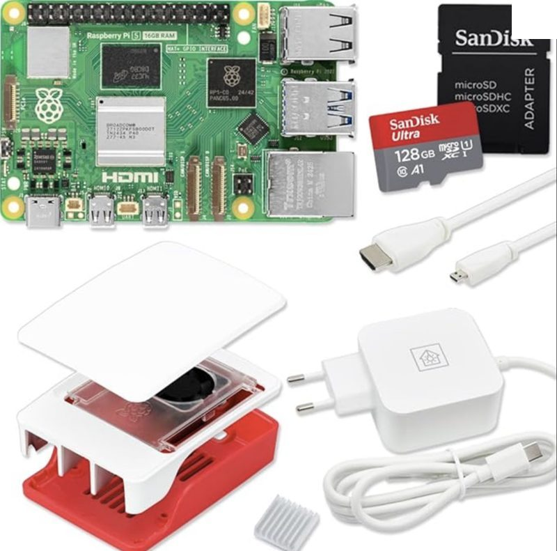
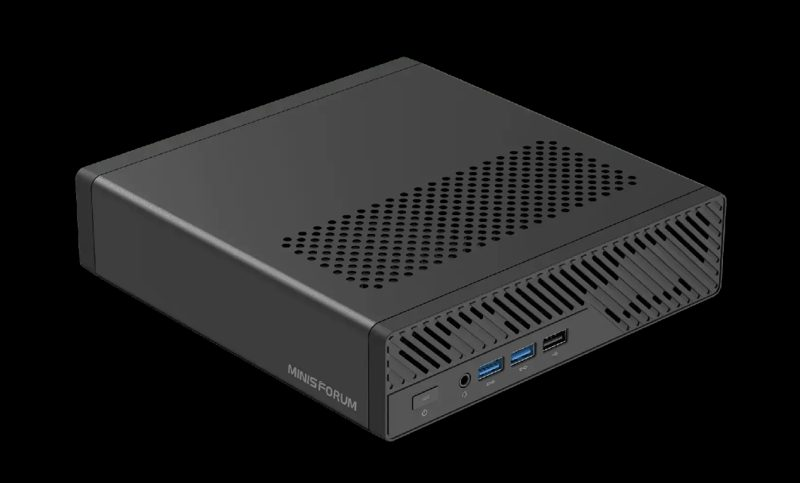
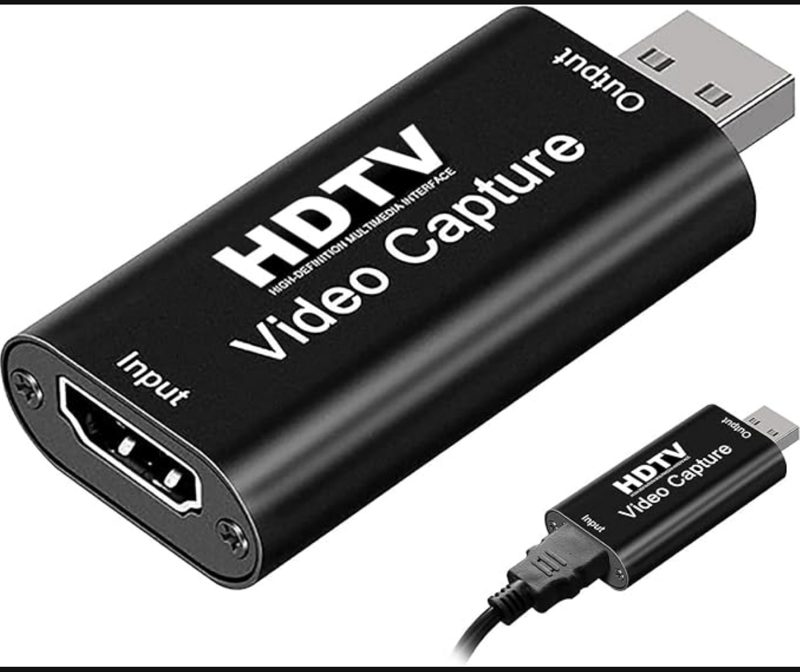

# Hardware

What to buy to run VirtualPyTest, with the sizes we run ourselves.

You need two things: a **host** (the computer VirtualPyTest runs on) and one **HDMI capture card per device** you want to test.

<div data-technical>

Prices are the usual street prices in Europe. Listings churn, so pick the item that matches the description. Everything below is hardware we run ourselves.

</div>

---

## Which host?

| | Standalone: Raspberry Pi 5 | Lab: Mini PC with Proxmox |
|---|---|---|
| **Best for** | First try, demo, up to 4 devices | Several racks of devices, Android emulators (64 GB), GPU for a local LLM |
| **Runs** | Everything in Docker on one board | Proxmox with one VM per role |
| **Price** | ~€405 (complete kit) | from €839 |
| **Time to first test** | ~30 min | ~2 h |

Not sure? Start with the Raspberry Pi.

<div data-technical>

One Pi 5 16 GB runs 4 devices in our lab without issue. It stays useful later as a capture host next to the devices, when you add a mini PC.

</div>

---

## 1. Standalone: Raspberry Pi 5 (16 GB)



**Buy:** [Raspberry Pi 5 16 GB starter kit on Amazon](https://www.amazon.fr/dp/B0858JBNZF) — ~€405

The kit has everything in one box.

<div data-technical>

The kit contains the Pi with 16 GB RAM, a power supply, a case with a fan, a 128 GB microSD card, a heatsink and a micro-HDMI cable.

</div>

- **Get the 16 GB version.** It runs the platform plus 4 devices.
- Plug capture cards into the Pi's **blue USB 3.0 ports**.
- For two or more capture cards on one Pi, add a **powered USB 3.0 hub**.
- Use a **wired** network cable.

<div data-technical>

The 8 GB board is fine for one device. With four, the database, the backend and the video captures need the extra memory. Do not use a USB extension cable for a capture card. The Pi's own ports cannot power more than one card reliably while it captures. Wi-Fi drops are the most common cause of a device showing as offline.

</div>

**Then:** flash the 64-bit Raspberry Pi OS, get the code and start the Docker setup. See [Docker](docker.md).

<div data-technical>

Command for the last step: `git clone` the repo, then run the Docker quickstart.

</div>

---

## 2. Lab: Minisforum MS-A2 with Proxmox



**Buy:** [Minisforum MS-A2 Workstation, 32 GB RAM + 1 TB SSD](https://minisforumpc.eu/products/ms-a2-mini-pc?variant=52008103772526) — €839 (list €1,049)

| Spec | MS-A2 |
|---|---|
| CPU | AMD Ryzen 9 9955HX, 16 cores / 32 threads |
| RAM | 32 GB DDR5 (64 GB and 96 GB variants exist, 2 SO-DIMM slots) |
| Storage | 1 TB NVMe, three NVMe slots total (2× M.2 + 1× U.2) |
| Network | 2× 2.5 GbE RJ45, 2× 10 GbE SFP+, Wi-Fi 6E |
| GPU | Radeon 610M integrated. PCIe x16 slot (x8 bandwidth) takes a **discrete GPU** for local AI |

Install **Proxmox VE** on it, then create these VMs:

| VM | vCPU | RAM | Disk | Role |
|---|---|---|---|---|
| `vpt-core` | 4 | 8 GB | 60 GB | Server + frontend + database + Grafana (Docker) |
| `vpt-host-N` | 2 | 4 GB | 40 GB | One per group of devices. Video capture + device control |
| `vpt-emulator` (optional) | 8 | 12 GB | 40 GB | **One** Android emulator (mobile, tablet or TV). Full sizing: [Emulators](emulators.md) |

Physical devices connect to a **Raspberry Pi host** placed next to them (recommended; the Pi from section 1 does this job). They can also connect to a `vpt-host` VM with the USB capture cards passed through.

<div data-technical>

The `vpt-emulator` row: CPU type must be `host`. Physical devices passed through to a VM: Proxmox → VM → Hardware → Add → USB Device. The Pi and the VM options both use the FFmpeg capture pipeline.

</div>

### Never overcommit RAM

Keep the total memory of all VMs below your physical RAM. An overcommitted machine does not crash its VMs. It **freezes** them, and they still show as `running`.

<div data-technical>

**Keep the sum of all VM memory at or below physical RAM minus 8 GB for Proxmox itself.** CPU can be shared between VMs; RAM cannot. When the machine runs out of RAM, it moves memory pages to disk while the VM still needs them. We learned this the hard way: a node at 120 % RAM allocation lost two VMs to frozen guests. One of them stayed stuck for 29 hours before anyone noticed. Emulator VMs go first, because they are the largest and the least able to lose memory.

</div>

So the RAM size you pick is the real decision:

| | 32 GB | 64 GB |
|---|---|---|
| Proxmox host | 4 GB | 4 GB |
| `vpt-core` | 8 GB | 8 GB |
| `vpt-host` | 4 GB | 4 GB |
| Emulator VMs | 1 × 12 GB | 3 × 12 GB |
| **Allocated** | **28 of 32 GB** | **52 of 64 GB** |
| Headroom | 4 GB — no second emulator, ever | comfortable |

**Take 64 GB** if you test on emulators. 32 GB fits the platform and one emulator.

<div data-technical>

32 GB fits the platform plus exactly one emulator, with nothing left over. 32 GB is fine for a lab that drives physical devices through capture cards, because the Pis do the work. The local LLM in section 4 needs 64 GB on its own, on top of this.

The graphics chip is the real difference from a Pi. A Pi has none. The MS-A2 has a built-in one and a slot for a proper graphics card. That is what makes local AI possible on it.

</div>

---

## 3. HDMI capture card (one per device)



**Buy:** [HDMI → USB capture card on Amazon](https://www.amazon.fr/dp/B0H6WQ2VXC) — €7

This is the MS2109 card.

<div data-technical>

The card is the MacroSilicon **MS2109**, sold as "USB 3.0 HDMI video capture card" and shown as USB ID `534d:2109`. Our lab runs one on every set-top box and TV, four per host.

</div>

- HDMI in, USB out. Linux sees it right away. There is nothing to install.
- Buy one per device, plus a spare.
- From the **third card on a host**, add a powered USB 3 hub.
- For phones and tablets, add a **USB-C to HDMI adapter**. Or skip HDMI and capture the screen over ADB instead.

<div data-technical>

It captures 1080p at 30 fps, with audio. It accepts 4K input and captures at 1080p, which is enough for image and text checks. Without power, the cards drop off the bus. Each card can feed one video capture process. Pricier cards (Elgato Cam Link, Magewell) work, but the platform gains nothing from them. At this price a dead unit is not worth debugging.

Technical details: one dongle per ffmpeg process. The card appears as a V4L2 camera and an ALSA sound card. Each card also exposes a USB audio input (`plughw:N,0`) that you can record alongside the video. The MS2109 cards share one controller's bandwidth and power, which is why an unpowered hub makes them drop out.

</div>

If the card drops out after a few seconds, check the USB link first. See [HDMI Capture Not Working](../user-guide/troubleshooting.md#hdmi-capture-not-working).

<div data-technical>

Check for an extension cable, an unpowered hub, or a Pi port under load.

</div>

---

## 4. Optional: local LLM on the same Proxmox

You can run a local model on the MS-A2, so AI traffic stays on your network. This needs the **64 GB** variant and a second NVMe drive. There are two ways to run it:

- **GPU (recommended):** a discrete GPU with 16 GB of video memory, passed through to a VM.
- **CPU only:** no extra hardware, but slow.

<div data-technical>

The GPU runs a model with Ollama or vLLM and gives tens of tokens per second. Check the card's length and power needs against the MS-A2 case before you buy. The built-in Radeon 610M is too small for this. It only handles the display and video decoding.

The CPU option is Colibri, described below.

```
VM 100 — AI                          VM 101 — AI Agent
────────────────────────             ────────────────────────
16 vCPU                              8 vCPU
32 GB RAM                            16 GB RAM
1 TB NVMe passthrough                256 GB disk

Colibri + GLM-5.2                    Ubuntu 24.04
10.10.10.10:8000                     OpenCode, Aider, Git, Docker,
        ▲                            Node, Python, Go/Rust
        │ HTTP / OpenAI API          Repositories: /workspace
        └─────────────────────────── 10.10.10.20
```

- **VM 100** runs [Colibri](https://www.alphamatch.ai/blog/colibri-ai-engine-glm-5-2-25gb-ram-2026) (CPU path), a CPU-only inference engine that serves GLM-5.2 (744 B parameters, mixture of experts) from about 25 GB of RAM by streaming experts from NVMe. The NVMe passthrough is not optional: the engine's speed is the disk's speed. Expect on the order of 1 token per second at best, so it suits batch jobs, not interactive chat.
- **VM 101** is a coding-agent box. OpenCode and Aider talk to VM 100 over its OpenAI-compatible API.
- **VirtualPyTest uses it too.** In Settings → AI → **Endpoints**, add an endpoint with the *OpenAI-compatible* preset and base URL `http://10.10.10.10:8000/v1` (no key; *reach* = server if the VirtualPyTest server can reach it, host if only the hosts can). Press **Test** to list its models, then create a **Profile** with the model name. In **Routing**, point the use cases you want at it (all agents, all vision, or single ones such as the channel banner), ideally with a cloud profile as fallback. Nothing goes in `.env`. Any OpenAI-compatible server works: Ollama, vLLM, llama.cpp, LM Studio, Colibri. See [AI routing](../agent/ai/AI_ROUTING.md).

</div>

Once the model runs, you choose which VirtualPyTest jobs use it. The steps are in the technical details.

---

## Proxmox node sizing (full fleet)

For the [full fleet layout](proxmox.md#proxmox-fleet), size the node itself. Section 2 sizes a single MS-A2.

| | Minimum | Comfortable (what this project runs) |
|---|---|---|
| **Proxmox node** | 8 cores / 16 threads · 64 GB RAM · 2 × 1 TB NVMe (mirror) · 1 GbE | AMD Ryzen 9 3900 (12 c / 24 t) · 128 GB RAM · 2 × 1.9 TB NVMe in RAID 1 — carries 19 VMs with ~150 GB allocated |
| **One VM running everything** ([one VM](proxmox.md#one-vm) or [Docker](docker.md)) | 4 cores · 8 GB · 60 GB disk | 6 cores · 16 GB · 120 GB NVMe, plus 2 cores and 4 GB per capture card attached to it |
| **Host VM** (device controller, one per group of devices) | 4 vCPU · 8 GB · 32 GB disk | same; USB devices passed through from the node |

Any x86 machine that runs Debian can be a Proxmox node. Capture cards and IR transmitters plug into the node and are passed on to the host VM.

<div data-technical>

A Proxmox node can be a rented server, a tower with two NVMe drives, or a small NUC-style box for a small fleet. It needs one network port on the LAN the devices live on.

Passing a USB device through: Hardware → Add → USB device.

</div>

### A host can also be its own x86 box

The host role can run on its own small machine instead of a Pi, for example next to a TV rack.

| Machine | Fits | Notes |
|---|---|---|
| **Raspberry Pi 5** (section 1) | 1–4 devices, IR/Bluetooth remotes, web tests | No hardware H.264 encoder: 1080p capture is CPU-bound, so keep the frame rate low. Built-in Bluetooth adapter is good for remote emulation |
| **Minisforum N100 mini PC** (16 GB, 512 GB NVMe) | 2–4 devices with HDMI capture | Hardware video encode, 4+ USB 3 ports, x86 so identical to the VM path |

<div data-technical>

Any Linux x86 box with USB 3 ports works the same way. Install script: `setup/local/linux/backend_host/install_host.sh`

</div>

---

## Control hardware (only for devices without network or ADB control)

Only for devices that cannot be controlled over the network or ADB:

- **USB IR transmitter** (~15–30 €): sends remote-control keys to set-top boxes and TVs.
- **Bluetooth adapter** (~10 €): for Bluetooth remote emulation.
- **Smart plug** (Tapo P100/P110, ~10 €): cuts the power to a device from a test, to restart it.

<div data-technical>

- **IRTrans LAN box** (~250 €): one networked IR box that drives up to 16 set-top boxes through LED outputs.
- **USB-C hub with HDMI** (~20 €): for phones and tablets. HDMI goes out to a capture card, and ADB runs over the same cable.
- **HDMI splitter** (~15 €, optional): keeps a monitor showing the device while it is being captured.
- The USB IR transmitter works with any `lirc`-compatible device, such as a USB IR Toy or any `ir-ctl` device. The Pi 5 has a Bluetooth adapter built in. On x86, use a plain USB BLE dongle.

Device settings for these, by type:

| Item | Use | Price |
|---|---|---|
| **USB IR transmitter** (`lirc`-compatible: USB IR Toy, or any `ir-ctl` device) | set-top boxes and TVs with an IR remote; declared as `DEVICEn_IR_PATH=/dev/lircN` on a Pi, or `DEVICEn_IR_SERIAL=/dev/irtoy` on a non-Pi host | ~15–30 € |
| **IRTrans LAN box** | one networked IR box driving up to 16 STBs by LED output; declared with `DEVICEn_IR_IP` / `_IR_LED` | ~250 € |
| **Bluetooth adapter** | Bluetooth remote emulation (Pi 5 built-in works; on x86 a plain USB BLE dongle) | ~10 € |
| **Smart plug** (Tapo P100/P110) | power-cycle a device from a test (`DEVICEn_POWER_*`) | ~10 € |
| **USB-C hub with HDMI** | phones/tablets: HDMI out to a capture dongle, ADB over the same cable | ~20 € |
| **HDMI splitter** (optional) | keep a monitor on the device while capturing | ~15 € |

</div>

Android devices reachable over the network need nothing but ADB enabled. Web targets need nothing.

## Shopping list

| Setup | Items | Total |
|---|---|---|
| **Standalone, 1 device** | Pi 5 16 GB kit + 1 capture card + 1 HDMI cable | ~€420 |
| **Standalone, up to 4 devices** | above + powered USB 3.0 hub + 1 capture card per device | ~€480 |
| **Lab, physical devices** | MS-A2 32 GB + 1 Pi kit per device rack + 1 capture card per device | from €1,260 |
| **Lab + emulators** | MS-A2 **64 GB** (€1,379) + Pi kits + capture cards — 32 GB fits only one emulator VM | from €1,800 |
| **Lab + local LLM** | MS-A2 64 GB (€1,379) + second 1 TB NVMe + discrete GPU 16 GB VRAM + Pi kits + capture cards | from €2,400 |

Optional, only for devices that have no network or ADB control:

| Item | Use |
|---|---|
| USB infrared transmitter (FLIRC or USB IR Toy) | Sends remote-control keys to a set-top box |
| Smart plug | Power-cycles a device from a test |

---

## Start in 3 steps

1. Buy a host and one capture card per device.
2. Connect each device's HDMI out to its capture card, and the card to a host USB port.
3. Install the software: [Docker](docker.md) or [Proxmox](proxmox.md).

<div data-technical>

Put the host on a wired network connection.

</div>

---
